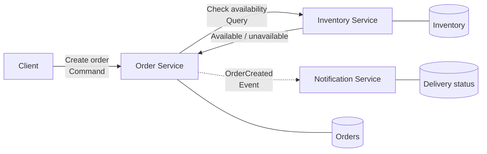
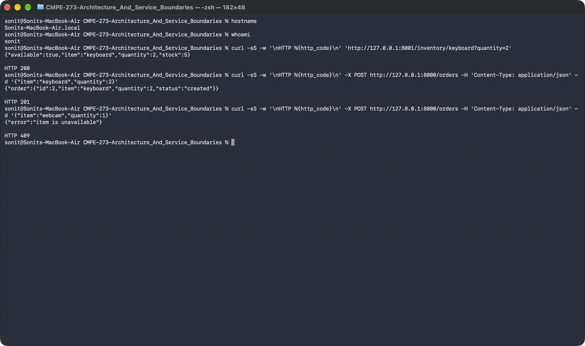
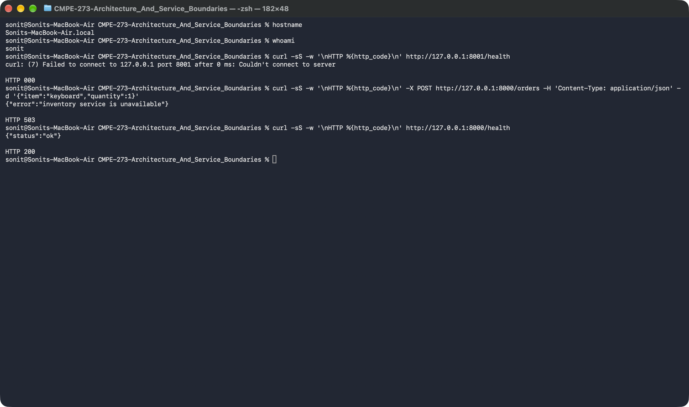

# Store Service Boundaries

A small distributed store application for CMPE 273. The implementation focuses on the synchronous interaction between the Order and Inventory services. Notification is included in the design to show where the `OrderCreated` event would be consumed.

## Architecture



### Responsibilities and data ownership

| Component | Responsibility | Data it owns |
| --- | --- | --- |
| Order Service | Validates requests, checks stock, and creates accepted orders | Order ID, item, quantity, and order status |
| Inventory Service | Answers availability questions for store items | Item IDs and stock counts |
| Notification Service | Would react to `OrderCreated` and notify the customer | Notification attempts and delivery status |

### Why these service boundaries

These boundaries follow business responsibilities. Inventory remains the only authority on stock, so Order does not keep a second copy that could become stale. Notification is separate because delivery failures should not prevent an order from being accepted. Only Order and Inventory are implemented because the required interaction for this assignment is the availability check.

## Command, query, and event

| Interaction | Type | Why |
| --- | --- | --- |
| Check whether an item is available | Query | It requests information and does not ask Inventory to change state. |
| Create an order | Command | It asks Order to perform an action that may create a new record. |
| Order was created | Event | It states a fact that already happened and can be consumed by other services. |

## Run locally

Requires Python 3.10 or newer.

```bash
python3 -m venv .venv
source .venv/bin/activate
python -m pip install -r requirements.txt
```

Start each service in a separate terminal from the repository root:

```bash
# Terminal 1
python inventory_service/app.py

# Terminal 2
python order_service/app.py
```

Inventory listens on `http://127.0.0.1:8001` and Order listens on `http://127.0.0.1:8000`. The sample inventory contains 5 keyboards, 2 monitors, and 0 webcams. To use a different Inventory URL, set `INVENTORY_URL` before starting Order.

## Successful request

With both services running, an order for two keyboards returns `HTTP 201` with a created order. The screenshot also shows the Inventory query returning `HTTP 200` and an unavailable webcam returning `HTTP 409`. It was captured locally on `Sonit’s MacBook Air` as user `sonit`.



## Inventory failure test

After stopping Inventory with `Ctrl-C`, the screenshot shows that port 8001 cannot be reached. Order then returns `503 Service Unavailable`, while a request to Order's health endpoint still returns `HTTP 200`, confirming that the process did not crash.



## Tests

```bash
python -m unittest discover -s tests -v
```

## Reflection

Clear service boundaries keep each business responsibility understandable and independently changeable. Explicit data ownership prevents two services from treating different copies of the same data as the truth. These decisions also make failures easier to contain, as shown when Order stays available even though Inventory is down. Without clear boundaries, small changes can create hidden dependencies across the system.
